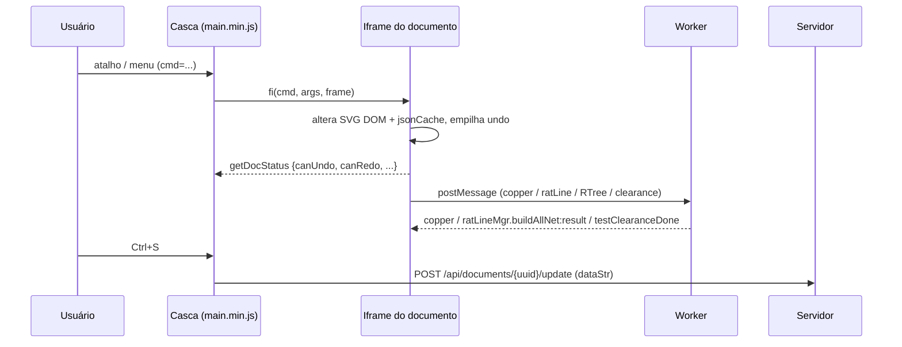

# 02 — Fluxos de eventos

Tudo aqui é INFERIDA: veio de código estático e não foi observado.

- Teclado: tabela única `[comando, escopo ALL|SCH|PCB, tecla, descrição]`, despachada pelo nome do comando. Encontrei 3 listeners `keydown` e 8 referências a `wheel`. CONFIRMADA (tabela) / INFERIDA (despacho).
- Comandos de UI: o atributo `cmd=` em itens de menu chama um despachante central. CONFIRMADA (264 comandos) / INFERIDA (mecanismo).
- Mensagens de `window` (postMessage) tratam `report`, `clone`, `_getLibUrl` e um fallback `e[a]()`. Esse fallback é uma superfície de integração entre janelas. CONFIRMADA (@~1131200).
