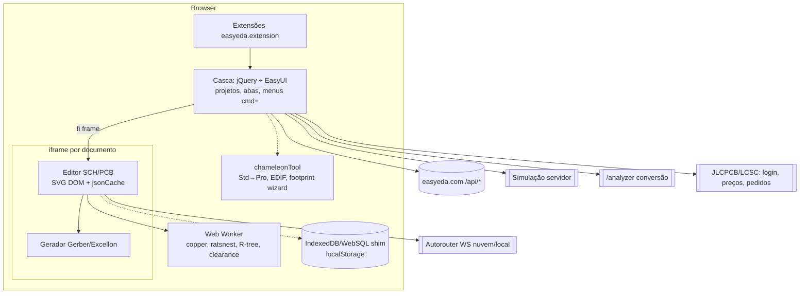

# 09 — Arquitetura do EasyEDA Standard (reconstruída)

Legenda dos diagramas: linhas sólidas são CONFIRMADA (código/string/doc) e linhas tracejadas são INFERIDA.

Características principais:
- monolito de front-end, com o DOM SVG como modelo de cena;
- isolamento por iframe;
- cálculos pesados no worker;
- serviços especializados no servidor (simulação, conversão, roteamento, catálogo).
