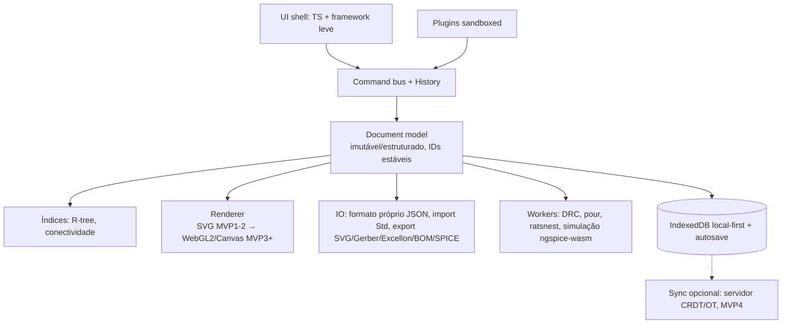

# 10 — Arquitetura própria proposta

Princípio: **o modelo é a fonte da verdade; a renderização é derivada.** É o oposto do EasyEDA, onde o SVG DOM é o modelo.

Camadas:
1. `core` (puro TS, sem DOM, 100% testável). Contém documento, comandos reversíveis, histórico, geometria e conectividade. O protótipo já implementa isso em `prototype/src/core`.
2. `format`: parser e serializador, versionados e com migrações. Já existe o leitor e escritor Std em `prototype/src/format`.
3. `render`: o renderizador lê o modelo e o viewport, e é trocável.
4. `engines` em workers, comunicando por mensagens tipadas.
5. `app`: ferramentas como máquinas de estado (idle, desenhando fio, arrastando).
6. `plugins`: API pública estável que chama comandos, não o DOM.
